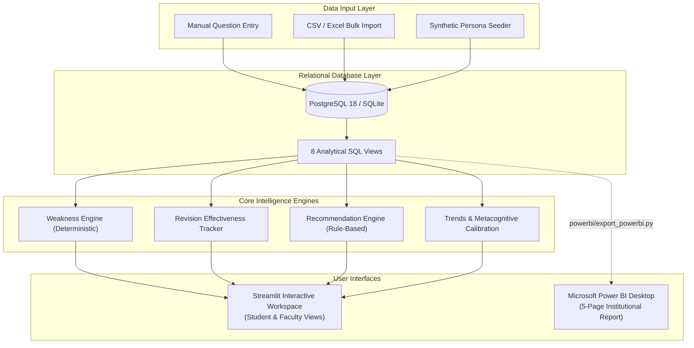

# GradeLens: Academic Performance Analytics & Weakness Detection Platform

[](https://www.python.org/)
[](https://streamlit.io/)
[](https://www.postgresql.org/)
[](https://powerbi.microsoft.com/)
[](LICENSE)
[](tests/)

> **Day 13 of the 90 Days — 90 Projects Challenge**  
> Built by a final-year B.Tech Artificial Intelligence & Data Science student preparing for software engineering, data analytics, and machine learning roles.

---

## 1. Project Overview & Motivation

Traditional academic dashboards only answer high-level questions such as *"What is the student's overall GPA?"* or *"Did the student pass Mathematics?"*. They fail to provide answers when a student repeatedly forfeits marks on specific concepts, confuses formulas, or struggles with time management during exams.

**GradeLens** transforms raw marks into granular, question-level intelligence. By linking individual examination questions to curriculum topics and cognitive mistake categories, GradeLens enables deterministic weakness detection, tracks whether revision yields measurable improvement, and helps faculty identify students who need academic support before semester finals.

### The Central Differentiator
$$\text{Exam Outcomes} \longrightarrow \text{Question-Level Responses} \longrightarrow \text{Topic Weakness Engine} \longrightarrow \text{Revision Planner} \longrightarrow \text{Post-Revision Score Comparison}$$

---

## 2. Key Capabilities & Features

### 🔍 1. Question-Level Performance Tracking
- Records outcomes at the individual question level: maximum marks, obtained marks, difficulty (`Easy`, `Medium`, `Hard`), question type (`MCQ`, `Short Answer`, `Numerical`, `Long Answer`, `Code`), and answer status (`Correct`, `Partially Correct`, `Incorrect`, `Unanswered`).
- Categorizes errors into explicit root causes: `Conceptual misunderstanding`, `Calculation error`, `Formula error`, `Careless mistake`, `Incomplete answer`, `Time-management issue`, or `Unanswered question`.
- Captures metacognitive confidence ratings (`Low`, `Medium`, `High`) to detect **"Blind Spots"** (high confidence paired with incorrect answers).

### 🧠 2. Deterministic Topic Weakness Detection Engine
- Classifies syllabus topics into transparent states without black-box ML:
  - **Repeated Weakness**: Scored $< 60\%$ across $\ge 2$ separate examinations.
  - **Weak**: Single assessment score $< 60\%$.
  - **Monitoring**: Score between $60\%$ and $74.9\%$.
  - **Strong**: Mastery $\ge 75\%$.
  - **Improving**: Recent performance gains $\ge 15\%$ points over historical baseline.
  - **Declining**: Recent drop $\ge 15\%$ points.
  - **Insufficient Data**: Fewer than the configured minimum threshold (default: 2 questions).
- Generates natural, evidence-backed explanations:
  > *"Probability is classified as Repeated Weakness because performance remained below 60% across 3 separate assessments (Overall Accuracy: 42.5%), predominantly driven by 'Calculation error' (4 occurrences)."*

### 📈 3. Revision Effectiveness Tracker
- Directly correlates recorded revision sessions (duration, revision method, notes) with subsequent examination performance.
- Frames findings with scientific integrity as an **observed comparison**, avoiding unsupported claims of causal proof.
  > *"Across 2 revision sessions (105 mins total), observed score on Gradient Descent changed from 40.0% to 90.0% (+50.0% gain). Observed comparison; individual results may depend on assessment difficulty."*

### 💡 4. Rule-Based Academic Recommendations
- Generates prioritized, deduplicated recommendations:
  - Repeated weakness $\rightarrow$ High Priority intensive revision schedule.
  - Calculation errors $\rightarrow$ Targeted formula reference sheets and step-by-step arithmetic drills.
  - Declining trajectory $\rightarrow$ Immediate refresher review.
  - Unanswered questions $\rightarrow$ Time-management pacing drills.
- Full state management: `Active`, `In Progress`, `Completed`, `Dismissed`.

### 📅 5. Daily Revision Planner & Study Goals
- Daily tasks with priority flags, target dates, and status toggle (`Pending`, `In Progress`, `Completed`).
- Weekly milestone goals with progress monitoring and target scores.
- Session logging with study types: *Practice Problems, Concept Review, Flashcards, Peer Discussion, Mock Tests*.

### 🏫 6. Faculty Cohort Intelligence
- Class average, pass rates, and grade distribution histograms.
- Transparent at-risk student detection based on objective triggers ($<50\%$ overall or $\ge 2$ repeated weak topics).
- Hardest cohort topics ranking (identifying concepts causing the greatest mark losses across all students).

### 📊 7. Enterprise Power BI Integration
- Clean relational analytical layer featuring **8 reusable SQL views**.
- Automated CSV export pipeline (`powerbi/export_powerbi.py`) generating curated tables in `powerbi/data/`.
- 5-page report design specification with ready-to-use DAX measures.

---

## 3. Technology Stack

| Layer | Technologies |
|---|---|
| **Frontend UI** | Streamlit 1.66, Custom Cool-Neutral CSS Theme |
| **Backend / Processing** | Python 3.12, Pandas 3.1, NumPy 2.5 |
| **Database** | PostgreSQL 18 (Production Target) & SQLite (Zero-Setup Local Engine) |
| **Data Access / ORM** | SQLAlchemy 2.1, psycopg2-binary, Parameterized SQL |
| **Data Visualizations** | Plotly Express, Plotly Graph Objects |
| **Business Intelligence** | Microsoft Power BI Desktop (SQL Views & CSV Data Layer) |
| **Testing & QA** | pytest 9.1 (31 automated unit and integration tests) |

---

## 4. Architecture Overview



---

## 5. Project Directory Structure

```
90-days-90-projects-day-13-gradelens/
├── README.md                   # Complete documentation
├── QUICKSTART.md               # 2-minute setup guide
├── DEMO_SCRIPT.md              # 90-second portfolio walkthrough
├── LICENSE                     # MIT License
├── requirements.txt            # Python dependencies
├── pyproject.toml              # Build & pytest configuration
├── setup.bat                   # 1-click Windows setup
├── run.bat                     # 1-click Streamlit launcher
├── test.bat                    # 1-click Pytest runner
├── .env.example                # Environment variables template
├── .gitignore                  # Clean repository hygiene
├── app/
│   ├── main.py                 # Streamlit entrypoint & router
│   ├── auth.py                 # Safe demo role-based session state
│   ├── styles.py               # Minimalist cool-neutral theme CSS
│   ├── components/
│   │   ├── metrics.py          # Metric cards & reasoning boxes
│   │   └── navigation.py       # Sidebar navigation
│   └── views/
│       ├── overview.py         # Executive KPI dashboard (matches SaaS reference)
│       ├── exam_manager.py     # Question marks entry, add/edit exams, filters
│       ├── subject_intel.py    # Subject-level consistency & curriculum breakdown
│       ├── topic_weakness.py   # Core weakness & mistake detection
│       ├── performance_trends.py # Long-term trends & blind spot calibration
│       ├── revision_planner.py # Prioritized daily review tasks & weekly plan
│       ├── study_goals.py      # Benchmark target percentages & deadlines
│       ├── revision_history.py # Session logs & empirical before/after deltas
│       ├── faculty_dashboard.py# Cohort distributions & executive metrics
│       ├── student_performance.py# Individual student profile drilldown & advisory
│       ├── class_analytics.py  # Hardest questions & early warning at-risk matrix
│       ├── reports_export.py   # CSV/Excel exports & Power BI synchronization
│       ├── data_import.py      # Multi-tier CSV/Excel upload with validation
│       └── settings.py         # Database diagnostics & weakness engine thresholds
├── src/
│   ├── database/
│   │   ├── connection.py       # PostgreSQL & SQLite connection manager
│   │   ├── schema.py           # DDL execution & table verification
│   │   └── repository.py       # Parameterized database queries
│   ├── analytics/
│   │   ├── calculations.py     # Percentages, marks lost, ranking
│   │   ├── weakness_engine.py  # Deterministic weakness engine
│   │   ├── revision_tracker.py # Before vs after revision correlation
│   │   └── trends.py           # Trajectories & mistake distributions
│   ├── recommendations/
│   │   └── engine.py           # Deduplicated rule-based recommendations
│   ├── imports/
│   │   ├── validator.py        # CSV/Excel validator & transaction committer
│   │   └── templates.py        # Sample downloadable templates
│   ├── exports/
│   │   └── powerbi_exporter.py # Analytical views to CSV exporter
│   └── data/
│       └── seeder.py           # Multi-persona synthetic dataset generator
├── sql/
│   ├── schema.sql              # ANSI/PostgreSQL table schemas
│   └── views.sql               # 8 analytical SQL views
├── powerbi/
│   ├── README.md               # Power BI connection & DAX guide
│   ├── export_powerbi.py       # CLI export utility
│   └── data/                   # Generated Power BI CSV files
├── docs/                       # Technical & user manuals
└── tests/                      # 31 automated pytest cases
```

---

## 6. Step-by-Step Windows Installation

### Prerequisites
- **Operating System**: Windows 10 or 11 (64-bit)
- **Python**: Version 3.10 to 3.12 (Python 3.12 recommended)
- **Database (Optional)**: PostgreSQL 18 (if running in PostgreSQL mode). If PostgreSQL is stopped, GradeLens automatically runs in zero-setup SQLite mode with full functionality.

### Automated 1-Click Setup (Recommended)
Double-click `setup.bat` or run in PowerShell:
```powershell
.\setup.bat
```
This script will:
1. Verify Python 3.10+.
2. Create `.venv` virtual environment.
3. Install dependencies from `requirements.txt`.
4. Initialize the database schema.
5. Seed realistic student personas.
6. Export the Power BI analytical layer.

### Manual Setup
```powershell
# 1. Navigate to directory
cd "d:\90 days\90-days-90-projects-day-13-gradelens"

# 2. Create virtual environment
python -m venv .venv

# 3. Activate virtual environment
.\.venv\Scripts\Activate.ps1

# 4. Install dependencies
pip install -r requirements.txt

# 5. Initialize & Seed database
python -m src.data.seeder

# 6. Export Power BI data
python powerbi/export_powerbi.py

# 7. Start GradeLens
streamlit run app/main.py
```

---

## 7. Connecting to PostgreSQL

To connect GradeLens to a live PostgreSQL 18 instance:
1. Open `.env` and set:
   ```env
   DATABASE_TYPE=postgresql
   PGHOST=localhost
   PGPORT=5432
   PGDATABASE=gradelens_db
   PGUSER=postgres
   PGPASSWORD=your_password
   ```
2. Start the Windows PostgreSQL service:
   ```cmd
   net start postgresql-x64-18
   ```
3. Run `setup.bat` or `python -m src.data.seeder` to build tables and seed records.

---

## 8. Automated Test Suite

GradeLens includes a test suite covering database constraints, academic calculations, weakness classifications, recommendations, revision trackers, and file imports.

Execute the test suite via `test.bat` or:
```powershell
.\.venv\Scripts\python.exe -m pytest -v
```

### Verified Test Results
```
============================= test session starts =============================
platform win32 -- Python 3.12.6, pytest-9.1.1
collected 31 items

tests/test_academic_calcs.py::test_safe_percentage_edge_cases PASSED     [  3%]
tests/test_academic_calcs.py::test_calculate_subject_metrics_empty PASSED [  6%]
tests/test_academic_calcs.py::test_calculate_subject_metrics_valid PASSED [  9%]
tests/test_academic_calcs.py::test_calculate_difficulty_breakdown PASSED [ 12%]
tests/test_academic_calcs.py::test_calculate_student_ranking_ties_and_anonymization PASSED [ 16%]
tests/test_academic_calcs.py::test_compute_exam_progression PASSED       [ 19%]
tests/test_academic_calcs.py::test_compute_mistake_distribution PASSED   [ 22%]
tests/test_academic_calcs.py::test_compute_confidence_calibration PASSED [ 25%]
tests/test_database.py::test_schema_initialization PASSED                [ 29%]
tests/test_database.py::test_database_manager_status PASSED              [ 32%]
tests/test_database.py::test_check_postgres_availability_does_not_crash PASSED [ 35%]
tests/test_database.py::test_repository_students_query PASSED            [ 38%]
tests/test_database.py::test_repository_subjects_and_topics PASSED       [ 41%]
tests/test_database.py::test_marks_constraint_enforcement PASSED         [ 45%]
tests/test_faculty_analytics.py::test_faculty_class_aggregations PASSED  [ 48%]
tests/test_faculty_analytics.py::test_at_risk_student_detection_rules PASSED [ 51%]
tests/test_imports_exports.py::test_import_validation_valid_data PASSED  [ 54%]
tests/test_imports_exports.py::test_import_validation_detects_errors PASSED [ 58%]
tests/test_imports_exports.py::test_import_commit_transaction PASSED     [ 61%]
tests/test_imports_exports.py::test_powerbi_dataset_export PASSED        [ 64%]
tests/test_recommendations.py::test_recommendation_generation PASSED     [ 67%]
tests/test_recommendations.py::test_recommendation_deduplication PASSED  [ 70%]
tests/test_recommendations.py::test_recommendation_status_update PASSED  [ 74%]
tests/test_revision_planner.py::test_revision_task_lifecycle PASSED      [ 77%]
tests/test_revision_planner.py::test_study_goal_lifecycle PASSED         [ 80%]
tests/test_revision_planner.py::test_revision_effectiveness_computation PASSED [ 83%]
tests/test_weakness_engine.py::test_insufficient_data_classification PASSED [ 87%]
tests/test_weakness_engine.py::test_strong_topic_classification PASSED   [ 90%]
tests/test_weakness_engine.py::test_repeated_weakness_classification PASSED [ 93%]
tests/test_weakness_engine.py::test_improving_topic_classification PASSED [ 96%]
tests/test_weakness_engine.py::test_seeded_student_weakness_detection PASSED [100%]

============================= 31 passed in 1.79s ==============================
```

---

## 9. Synthetic Demonstration Personas

GradeLens seeds reproducible academic personas designed to demonstrate distinct analytical features:

| Student Code | Name | Academic Persona & Scenario | Analytical Outcome |
|---|---|---|---|
| **STU101** | Aarav Sharma | Repeated weakness in *Dynamic Programming* & *SQL Joins* | Classified as `Repeated Weakness` (<60% in 3 assessments) |
| **STU102** | Diya Patel | Low initial ML score $\rightarrow$ revised twice $\rightarrow$ high score | Demonstrates `Revision Effectiveness` (+50% gain) |
| **STU103** | Rohan Iyer | High academic achiever ($\ge 88\%$ across all topics) | Classified as `Strong` across all subjects; Rank #1 |
| **STU104** | Ananya Sen | Severe academic struggle ($<45\%$ overall average) | Transparently flagged in `Faculty Analytics` as At-Risk |
| **STU105** | Vikram Nair | Exam pacing & time management lapses | High `Unanswered Questions`; triggers Time Management rule |
| **STU106** | Pooja Hegde | Moderate student ($60-70\%$ average) | Classified as `Monitoring` across syllabus topics |

---

## 10. Security & Privacy Considerations

- **Role-Based Isolation**: Students can access only their own assessment outcomes, personal revision tasks, and individual recommendations. Class rankings can be optionally anonymized (`Student #1`, `Student #2`).
- **Parameterized SQL**: All database operations use bound parameters, preventing SQL injection vulnerabilities.
- **Atomic Transactions**: File imports and response recordings execute inside database transactions; invalid batches trigger automatic rollbacks without leaving orphan rows.
- **Environment Isolation**: Production database credentials are kept in `.env` and excluded from version control via `.gitignore`.

---

## 11. Known Limitations

- **Subjective Mistake Attribution**: Mistake categories rely on teacher grading or student self-recording; GradeLens does not guess mistake categories without explicit evidence.
- **Power BI Live Sync**: When using the CSV data layer, users must click *"Refresh Datasets"* in Streamlit or run `powerbi/export_powerbi.py` before refreshing Power BI Desktop.

---

## 12. Technical Skills & Resume Keywords

`Python 3.12` • `Streamlit` • `PostgreSQL 18` • `Microsoft Power BI` • `DAX` • `SQL Views` • `Pandas` • `Plotly` • `Relational Modeling` • `Deterministic Analytics` • `Academic Intelligence` • `Weakness Attribution` • `pytest` • `Data Pipeline Design` • `Role-Based Access Control`

---

## 13. License

Distributed under the MIT License. See [LICENSE](LICENSE) for full details.
