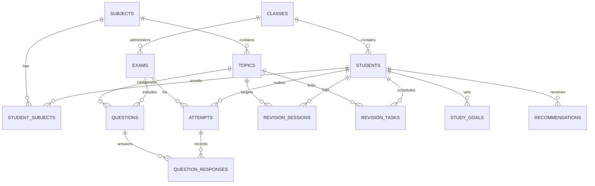

# GradeLens: Technical Architecture & Relational Design

## 1. System Architecture
GradeLens adopts a modular 4-tier architecture:

```
[Presentation Tier]
  Streamlit 1.66 Application (9 Views, Custom CSS Theme)
  Power BI Desktop Report (5 Pages, DAX Measures)
       ▲
       │
[Business Logic & Analytics Tier]
  - TopicWeaknessEngine (Deterministic Multi-Assessment Diagnostic)
  - RevisionTracker (Before vs After Longitudinal Correlation)
  - RecommendationEngine (Rule-Based Prioritized Strategy)
  - ImportValidator (Multi-Tier Validation & Transaction Processing)
       ▲
       │
[Data Access Tier]
  - Repository (Typed Parameterized SQL Queries & Transactions)
  - DatabaseManager (PostgreSQL 18 & SQLite Dual-Engine Support)
       ▲
       │
[Persistence Tier]
  PostgreSQL 18 / SQLite Relational Database (14 Tables, 8 Analytical SQL Views)
```

## 2. Entity-Relationship Schema



## 3. The 8 Analytical SQL Views
1. `vw_student_performance`: Student overall marks, possible marks, and percentage.
2. `vw_subject_performance`: Subject-level aggregates, highest, lowest, and marks lost.
3. `vw_topic_performance`: Question count, obtained, maximum, marks lost, and incorrect counts.
4. `vw_question_level_analysis`: Full flattened response log with mistake categories and difficulty.
5. `vw_exam_comparison`: Exam class averages, max, min, and candidate count.
6. `vw_revision_effectiveness`: Revision session hours and dates per student and topic.
7. `vw_faculty_class_analytics`: Class-level pass rates and below-threshold counts.
8. `vw_recommendation_summary`: Prioritized recommendations and completion states.
